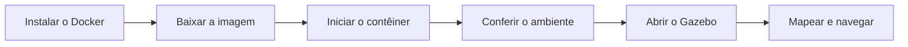

<div align="center">

<br>

# SETUP ROBÓTICA

**Ambiente de simulação pronto para uso, em um único contêiner Docker**

<sub>ROS 2 Foxy &nbsp;|&nbsp; Gazebo &nbsp;|&nbsp; TurtleBot3 &nbsp;|&nbsp; CycloneDDS</sub>

<br>


<br>

</div>

---
<div align="center">

</div>

## Visão geral

Este repositório ensina a montar, do zero, o ambiente usado nas práticas de robótica. Tudo já vem dentro de uma imagem Docker, então não é preciso instalar ROS, Gazebo ou TurtleBot3 diretamente no computador.

<br>

<div align="center">

| Componente | Versão / Configuração |
| :--- | :--- |
| Sistema da imagem | Ubuntu 20.04 (Focal) |
| ROS 2 | Foxy |
| Simulador | Gazebo Classic (`gazebo`, `gzserver`) |
| Middleware (RMW) | `rmw_cyclonedds_cpp`, já definido como padrão |
| Robô | TurtleBot3, modelo `burger` já definido |
| Imagem | `pedro3223/ros2-foxy-turtlebot3:1.0` |

</div>

<br>

> [!NOTE]
> O ROS 2 Foxy usa o Gazebo Classic. Por isso o comando é `gazebo`, e não `gz sim`.

### Fluxo de trabalho



---

## Requisitos

| Item | Recomendação |
| :--- | :--- |
| Sistema operacional | Linux baseado em Debian (Ubuntu, Zorin OS, Linux Mint, Debian) |
| Espaço em disco | Cerca de 9 GB livres |
| Download | Aproximadamente 1,8 GB |
| Memória RAM | 8 GB ou mais |
| Servidor gráfico | X11 (também funciona com XWayland) |

> [!IMPORTANT]
> Este guia foi escrito e testado para Linux. Os comandos de instalação usam o `apt`. Em outras distribuições (Fedora, Arch), o Docker deve ser instalado com o gerenciador de pacotes da própria distribuição, e o restante do guia continua valendo.

---
<div align="center">


</div>


## 02. Instalar o Docker

Atualize a lista de pacotes e instale o Docker:

```bash
sudo apt update
sudo apt install -y docker.io
```

Adicione o seu usuário ao grupo `docker`. Assim, os comandos funcionam sem `sudo`:

```bash
sudo usermod -aG docker $USER
```

> [!WARNING]
> Depois do comando acima, **saia da sessão e entre de novo** (ou reinicie o computador). Sem isso, o Docker continua pedindo `sudo`.

Teste a instalação:

```bash
docker run hello-world
```

Se aparecer uma mensagem começando com `Hello from Docker!`, está tudo certo.

---

## 03. Baixar a imagem

```bash
docker pull pedro3223/ros2-foxy-turtlebot3:1.0
```

O download é grande e pode demorar, dependendo da internet. Para confirmar que a imagem foi baixada:

```bash
docker images
```

A imagem `pedro3223/ros2-foxy-turtlebot3` deve aparecer na lista, com a tag `1.0`.

<details>
<summary><b>Tenho a imagem em um arquivo .tar. Como carrego?</b></summary>

<br>

```bash
docker load -i nome_do_arquivo.tar
```

</details>

---

## 04. Iniciar o contêiner

Para abrir janelas do Gazebo a partir do contêiner, é preciso liberar o acesso à tela. Rode **uma vez por sessão**:

```bash
xhost +local:docker
```

Agora inicie o contêiner:

```bash
docker run -it --rm \
  --name robotica \
  --net=host \
  -e DISPLAY=$DISPLAY \
  -v /tmp/.X11-unix:/tmp/.X11-unix \
  -v $HOME/robotica_ws:/root/robotica_ws \
  pedro3223/ros2-foxy-turtlebot3:1.0 bash
```

O que cada parte faz:

| Opção | Função |
| :--- | :--- |
| `-it` | Abre um terminal interativo dentro do contêiner |
| `--rm` | Apaga o contêiner ao sair (a imagem continua intacta) |
| `--name robotica` | Dá um nome ao contêiner, para abrir outros terminais nele |
| `--net=host` | Usa a rede do computador, necessário para a comunicação do ROS 2 |
| `-e DISPLAY=$DISPLAY` | Informa ao contêiner qual tela usar |
| `-v /tmp/.X11-unix:...` | Compartilha o servidor gráfico com o contêiner |
| `-v $HOME/robotica_ws:...` | Liga uma pasta do computador a uma pasta do contêiner |

> [!TIP]
> Com `--rm`, tudo o que for criado dentro do contêiner some ao sair. Salve seus arquivos em `/root/robotica_ws`. Essa pasta fica guardada no computador, em `~/robotica_ws`.

Ao terminar o trabalho, feche o acesso à tela:

```bash
xhost -local:docker
```

---

## 05. Conferir o ambiente

Dentro do contêiner, rode:

```bash
echo "ROS: $ROS_DISTRO"
echo "RMW: $RMW_IMPLEMENTATION"
echo "TB3: $TURTLEBOT3_MODEL"
```

Resultado esperado:

```text
ROS: foxy
RMW: rmw_cyclonedds_cpp
TB3: burger
```

Se o comando `ros2` não for reconhecido, carregue o ambiente do ROS:

```bash
source /opt/ros/foxy/setup.bash
```

---

## 06. Abrir o Gazebo com o TurtleBot3

### Terminal 1: simulação

Dentro do contêiner, inicie o mundo do TurtleBot3:

```bash
ros2 launch turtlebot3_gazebo turtlebot3_world.launch.py
```

Para um mundo vazio, use `empty_world.launch.py` no lugar de `turtlebot3_world.launch.py`.

### Terminal 2: controle pelo teclado

Abra outro terminal no computador e entre no mesmo contêiner:

```bash
docker exec -it robotica bash
```

Dentro dele, rode:

```bash
ros2 run turtlebot3_teleop teleop_keyboard
```


Use as teclas para mover o robô:

<div align="center">
<table style="border: none; border-collapse: collapse;">
  <tr>
    <!-- Coluna da Imagem (com altura controlada para alinhar com a tabela) -->
    <td align="center" valign="middle" style="border: none; padding-right: 30px;">
      
    </td>
    <!-- Coluna da Tabela de Comandos em HTML puro para garantir a renderização correta -->
    <td valign="middle" style="border: none;">
      <table>
        <thead>
          <tr>
            <th align="center">Tecla</th>
            <th align="left">Ação</th>
          </tr>
        </thead>
        <tbody>
          <tr>
            <td align="center"><kbd>W</kbd></td>
            <td align="left">Aumentar a velocidade linear</td>
          </tr>
          <tr>
            <td align="center"><kbd>X</kbd></td>
            <td align="left">Diminuir a velocidade linear</td>
          </tr>
          <tr>
            <td align="center"><kbd>A</kbd></td>
            <td align="left">Girar para a esquerda</td>
          </tr>
          <tr>
            <td align="center"><kbd>D</kbd></td>
            <td align="left">Girar para a direita</td>
          </tr>
          <tr>
            <td align="center"><kbd>S</kbd></td>
            <td align="left">Parar o robô</td>
          </tr>
        </tbody>
      </table>
    </td>
  </tr>
</table>
</div>

---
## 07. Comandos úteis do Docker

| Comando | O que faz |
| :--- | :--- |
| `docker images` | Lista as imagens baixadas |
| `docker ps` | Lista os contêineres em execução |
| `docker exec -it robotica bash` | Abre outro terminal no contêiner `robotica` |
| `docker stop robotica` | Para o contêiner |
| `docker rmi pedro3223/ros2-foxy-turtlebot3:1.0` | Remove a imagem do computador |
| `docker system df` | Mostra o espaço usado pelo Docker |

---

## 08. Solução de problemas

<details>
<summary><b>Erro: permission denied ao rodar o docker</b></summary>

<br>

O usuário ainda não está no grupo `docker`, ou a sessão não foi reiniciada. Rode:

```bash
sudo usermod -aG docker $USER
```

Depois saia da sessão e entre de novo. Para confirmar, o comando `groups` deve listar `docker`.

</details>

<details>
<summary><b>Erro: cannot open display, ou o Gazebo não abre</b></summary>

<br>

Confira estes três pontos:

1. O comando `xhost +local:docker` foi executado no computador, antes de iniciar o contêiner.
2. O contêiner foi iniciado com `-e DISPLAY=$DISPLAY` e com `-v /tmp/.X11-unix:/tmp/.X11-unix`.
3. A variável `DISPLAY` não está vazia no computador. Teste com `echo $DISPLAY`.

</details>

<details>
<summary><b>O Gazebo abre com tela preta ou fecha sozinho</b></summary>

<br>

Em computadores sem placa de vídeo dedicada, force a renderização por software. Dentro do contêiner, antes de abrir o Gazebo:

```bash
export LIBGL_ALWAYS_SOFTWARE=1
```

A simulação fica mais lenta, mas costuma resolver.

</details>

<details>
<summary><b>O comando ros2 não foi encontrado</b></summary>

<br>

```bash
source /opt/ros/foxy/setup.bash
```

</details>

<details>
<summary><b>O pull falha porque a imagem não é encontrada</b></summary>

<br>

Confira se o nome está exatamente como no guia: `pedro3223/ros2-foxy-turtlebot3:1.0`. Se o erro continuar, o repositório da imagem no Docker Hub pode estar privado.

</details>

---

---
<div align="center">


</div>
